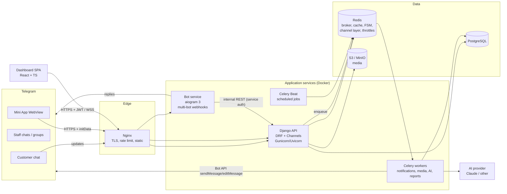
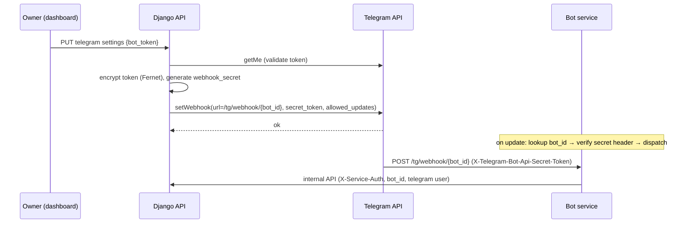
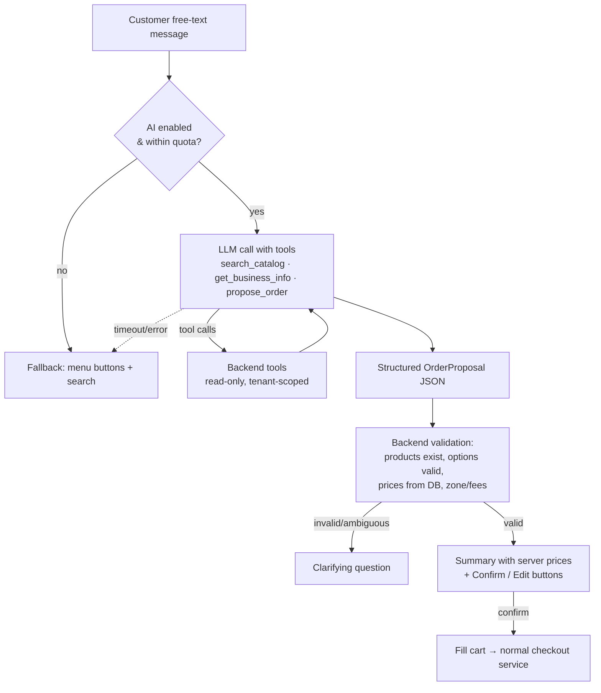

# 02 — System Architecture

## 1. Overview



### Service responsibilities

| Service | Owns | Does **not** do |
|---------|------|-----------------|
| **Django API** | All business logic and the database: catalog, pricing, carts, orders, state machine, RBAC, entitlements, AI orchestration, analytics. Exposes public API (dashboard, Mini App), internal API (bot), WebSocket. | Talk to Telegram synchronously inside a request. |
| **Bot service** | Telegram update handling, conversation state (FSM in Redis), keyboards, message rendering, i18n of bot copy. Stateless otherwise. | Touch PostgreSQL. Compute prices. Decide permissions. |
| **Celery workers** | Outbound Telegram messages, message edits, image processing, AI calls, report exports, cart expiry, auto-reject timers, subscription expiry. | Contain business rules — they call the same service layer as the API. |
| **Celery Beat** | Schedules periodic tasks. | — |
| **Nginx** | TLS termination, HTTP/2, request size limits, `limit_req`, serving built SPAs, proxying `/api`, `/ws`, `/tg`. | — |

**Single source of truth:** every rule (price, availability, transition permission, entitlement)
lives once, in the Django service layer. Bot, Mini App, dashboard, AI and Celery are all clients of it.
This is how "no duplicated business logic" is guaranteed.

## 2. Backend internal layering

```
HTTP / WS / internal API
        │
   views & consumers      ← thin: auth, parse, call service, serialize
        │
   serializers            ← input validation & output shape only
        │
   services (domain)      ← all business logic, transactions, events
        │
   selectors (queries)    ← tenant-scoped read queries
        │
   models                 ← schema, constraints, simple invariants
```

- **Services** are plain functions/classes (`orders.services.place_order(...)`), unit-testable without HTTP.
- **Domain events** (`order_placed`, `order_status_changed`, ...) are published with
  `transaction.on_commit(...)` so side effects (Celery tasks, WebSocket broadcast) happen only after a successful commit.

## 3. Multi-tenancy

**Model:** shared database, shared schema, every tenant-owned row has a non-null `business_id`.
(Schema-per-tenant was rejected — see ADR-002.)

Enforcement in depth:

1. **Request tenant resolution** — every tenant API lives under `/api/v1/b/{business_id}/...`.
   A DRF permission resolves the caller's `Membership` for that business (dashboard) or the
   customer's validated `business` (Mini App/bot). No membership → `404` (not `403`, to avoid
   enumeration).
2. **Tenant-scoped base classes** — `TenantViewSet` builds its queryset only via
   `Model.objects.for_business(request.business)`; `perform_create` injects `business` server-side;
   serializers never accept `business` as input.
3. **Cross-reference validation** — every FK supplied by a client (category, product, zone, staff)
   is validated against the same business (`TenantPrimaryKeyRelatedField`).
4. **Database constraints** — composite FKs/unique constraints include `business_id` where it matters
   (e.g. order number unique per business).
5. **PostgreSQL Row-Level Security (hardening phase)** — policies on tenant tables using
   `current_setting('app.business_id')`, set per transaction by middleware. Defence against a missed filter.
6. **Tests** — an automated suite iterates every tenant endpoint and asserts that a user of business A
   gets `404` for objects of business B (see 09-TESTING).

## 4. Telegram: multi-bot design

Each business can attach its own bot (token from BotFather). One bot service process serves all bots.



- The webhook URL contains an opaque `bot_id` (UUID), **never** the token.
- `secret_token` header is verified in constant time; mismatched requests are dropped with `401`.
- The bot service fetches (and caches in memory, short TTL) decrypted tokens from the internal API.
- **Shared platform bot** (lower plans): one platform bot; customers enter via `?start=<business_slug>`
  and the chat is bound to that business (switchable via `/start` with another slug).
- **Development:** a single bot in long-polling mode (`BOT_MODE=polling`), no public URL required.

### Bot ↔ backend contract

Internal API (`/internal/v1/...`) is reachable only on the Docker network (Nginx does not route it) and
requires an HMAC-signed service token. Every call carries `bot_id` and the Telegram user; the backend
derives business and customer itself.

## 5. Key flows

### 5.1 Placing an order (bot or Mini App)

```mermaid
sequenceDiagram
    participant C as Customer
    participant CL as Bot / Mini App
    participant API as Django (orders.services)
    participant DB as PostgreSQL
    participant Q as Celery
    participant S as Staff chats

    C->>CL: confirm order
    CL->>API: POST checkout {idempotency_key, fulfilment, contact, zone, address}
    API->>DB: BEGIN; SELECT cart FOR UPDATE
    API->>DB: existing order with idempotency_key? → return it (200)
    API->>DB: reload products/options FOR UPDATE (stock), re-price, validate rules
    API->>DB: allocate order number (per-business counter FOR UPDATE)
    API->>DB: INSERT order, items (snapshots), status history; decrement stock; clear cart
    API->>DB: COMMIT
    API-->>CL: 201 order
    CL-->>C: "تم استلام طلبك #1042 ✅"
    API->>Q: on_commit: notify_order_placed
    Q->>S: sendMessage with action buttons
```

The client shows success **only** after the `201/200` response — never before.

### 5.2 Status change from a Telegram button

Callback data: `o:{order_short_id}:{target_status}:{expected_version}` (≤ 64 bytes).

1. Bot answers the callback immediately (spinner off), then calls
   `POST /internal/v1/orders/{id}/transition {target, expected_version, telegram_user}`.
2. Backend maps the Telegram user → `User` → `Membership` in the order's business, checks permission
   `orders.transition.{target}`.
3. `UPDATE orders SET status=?, version=version+1 WHERE id=? AND version=?` — zero rows → stale/duplicate;
   the backend returns current state and the bot shows "already updated by Ali".
4. On commit: edit all staff messages for this order, notify the customer, push WebSocket event.

### 5.3 Real-time dashboard

Django Channels consumer `/ws/b/{business_id}/` authenticated by a short-lived WS ticket
(obtained via `POST /api/v1/auth/ws-ticket`, single use, 30 s) since browsers cannot set headers on
WebSocket. Groups: `business.{id}.orders`. Events are thin (`{type, order_id, status, version}`);
the client refetches through TanStack Query.

### 5.4 AI-assisted ordering



The LLM never sees write tools. Prices shown to the customer come from validation, not from model output.

## 6. Configuration

- `django-environ`-style settings from environment variables; settings split into `base`, `dev`, `test`, `prod`.
- Secrets only via environment / Docker secrets; `.env.example` documents every variable (doc ENVIRONMENT.md in Phase 9).
- Business-level configuration lives in the DB (`BusinessSettings`, `TelegramConfig`); sensitive fields encrypted.
- Feature flags per business come from entitlements (doc 04 §subscriptions).

## 7. Background tasks (Celery queues)

| Queue | Tasks | Notes |
|-------|-------|-------|
| `telegram` | send/edit messages, setWebhook | Per-bot token-bucket rate limiter in Redis; retries with backoff on 429 using `retry_after` |
| `default` | auto-reject timers, cart expiry, subscription checks | |
| `media` | image re-encoding, thumbnails | |
| `ai` | AI conversations (if routed async) | Hard time limit |
| `reports` | CSV/XLSX exports | Result stored in S3 with signed URL |

All tasks are idempotent (keyed by order id + event version) so retries never double-send.

## 8. Logging and monitoring

- JSON logs (structlog) with `request_id`, `business_id`, `user_id`, `update_id`; PII (phone, address) masked.
- Sentry for API, bot, workers and both SPAs (separate projects/environments, PII scrubbing on).
- Health: `/healthz` (liveness), `/readyz` (DB, Redis, migrations applied). Bot and worker health via heartbeat keys in Redis.
- Metrics: Prometheus endpoint (`django-prometheus`) + Celery queue length; optional Grafana.

## 9. Scaling path

1. Single host, Compose (v1 target, NFR-4).
2. Split DB to managed PostgreSQL, add read replica for analytics.
3. Run multiple API / worker / bot replicas behind Nginx (all stateless; FSM & sessions in Redis).
4. Partition `orders` by month if > 100M rows; move analytics to pre-aggregated daily tables (already planned: `analytics_dailybusinessstats`).
