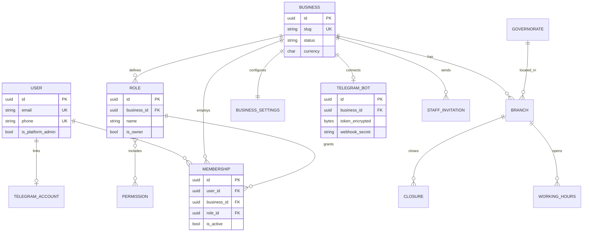
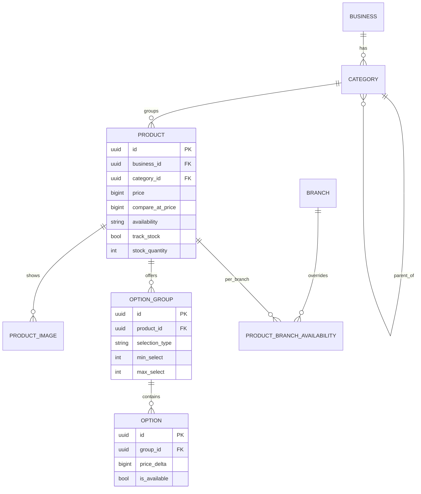
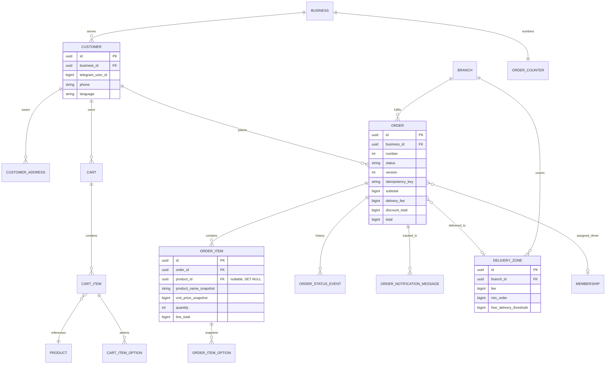
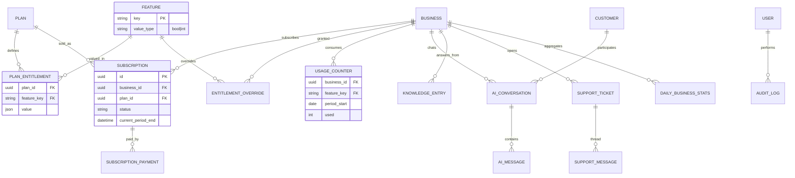

# 03 — Entity-Relationship Diagrams

Split by domain for readability. Field details are in [04-DATA-MODELS.md](04-DATA-MODELS.md).
Every entity marked *(T)* carries `business_id` and is tenant-scoped.

## 1. Identity, businesses, staff

## 2. Catalog

## 3. Customers, carts, orders, delivery

## 4. Subscriptions, AI, platform

