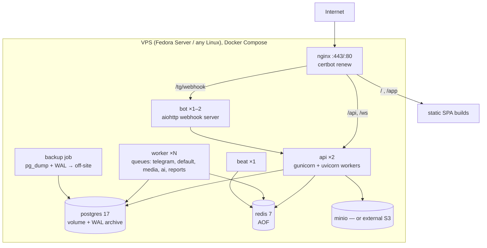

# 10 — Deployment Architecture

Detailed, command-level runbooks (FEDORA_SETUP, DEVELOPMENT, DEPLOYMENT, ENVIRONMENT,
BACKUP_RESTORE, TROUBLESHOOTING) are written in Phase 9. This document fixes the target design.

## 1. Production topology (v1, single host)

Domains (example): `app.example.iq` (dashboard + API), `shop.example.iq` (Mini App), `api` under `/api`.
Telegram requires HTTPS for webhooks and Mini Apps → Let's Encrypt via certbot (HTTP-01) on Nginx.

## 2. Containers

| Service | Image | Notes |
|---------|-------|-------|
| api | `backend` multi-stage (uv → slim runtime), non-root | Runs `migrate` in a one-off `release` job, not on every start |
| worker / beat | same `backend` image, different command | `--max-tasks-per-child`, time limits |
| bot | `bot` image | Webhook server on internal port; registers webhooks via API |
| nginx | `nginx:stable` + built SPAs copied from `frontend` build stage | |
| postgres | `postgres:17` | tuned config, `archive_mode=on` |
| redis | `redis:7` | password, AOF, `maxmemory-policy noeviction` for broker DB |
| minio | dev only (prod: external S3 recommended) | |

All services: healthchecks, `restart: unless-stopped`, resource limits, logs to stdout (JSON) with
Docker `local` driver + rotation; only Nginx exposes ports.

## 3. Release process

1. CI builds and tags images (`git sha`), pushes to registry (GHCR).
2. On server: `docker compose pull` → `docker compose run --rm release` (migrate, collectstatic, sync permissions/features) → `docker compose up -d` (rolling for api replicas).
3. Smoke checks: `/readyz`, bot webhook `getWebhookInfo` for each bot, test order on staging business.
4. Rollback: previous image tag + backward-compatible migrations (expand/contract policy).

Environments: `dev` (local Compose, polling bot), `staging` (separate server/bot tokens), `prod`.

## 4. Backups

- Continuous WAL archiving → PITR, RPO ≤ 15 min. Implemented with PostgreSQL's own `pg_receivewal` + `pg_basebackup` (no extra binary in the image), synced off-site every 5 min with rclone crypt; wal-g/pgBackRest remain the upgrade path for multi-server setups.
- Nightly full backup, retention 7 daily / 4 weekly / 6 monthly, encrypted.
- Media bucket versioning/replication.
- Monthly restore drill into a scratch container, documented in BACKUP_RESTORE.md.

## 5. Monitoring

Sentry (errors, performance) · UptimeRobot/Healthchecks.io on `/readyz` and Beat heartbeat ·
Prometheus metrics + Grafana (optional) · alerts: error rate, queue backlog > N, webhook errors,
disk > 80 %, backup age > 26 h, certificate expiry < 14 days.

## 6. Fedora notes

- Development on Fedora 44 with Docker Engine (Docker CE repo) or Podman + `podman compose`. Docker CE is the documented default.
- SELinux stays **enforcing**: bind mounts use `:Z`/`:z` labels.
- `firewalld`: only 80/443 (and SSH) open in production.
